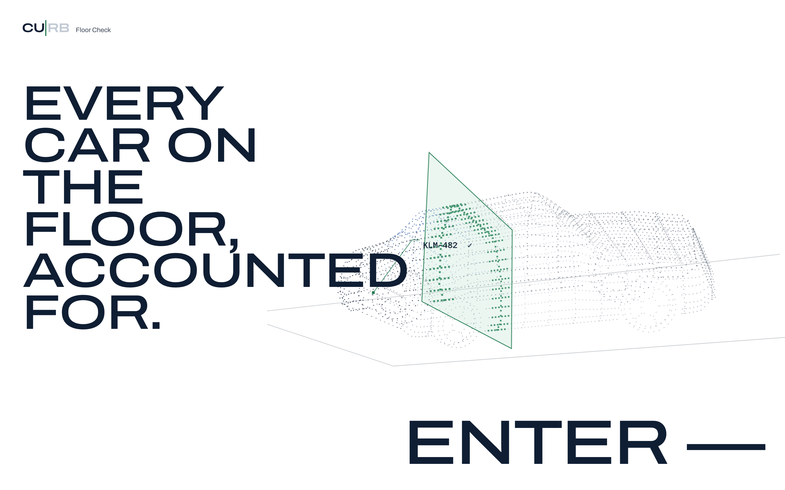

# Curb Floor Check

**Verify a dealer's floor without walking it.** Data does the routine work; people make every call.



Banks that lend dealers money for their stock (floor plan finance) send an inspector to count the cars every year. It is slow and expensive, and a car sold last week still slips through. Floor Check replaces most of that walk:

1. **Data.** Connected-car GPS, marketplace listings and the vehicle register watch every financed car, all the time.
2. **Self-check.** Now and then the bank opens a two-hour window. The dealer photographs a few cars with their phone, about two minutes a car.
3. **Spot check.** At random, a vetted local freelance verifier visits and photographs a few cars, for €30 an hour instead of €170 per car.
4. **Full count.** An inspector counts every car, but only after a confirmed problem.

AI models read the photos and rank the risk. A person makes every decision.

> Built as a prototype for the TiK × Netlight Mini Hackathon (Case 2, Floor Check). All data is simulated.

## What's inside

| Route | What it is |
|---|---|
| `/` | The story: the problem and each part of the answer, in eight animated chapters |
| `/dealer` | Dealer phone app: check-in window, "ask for another time", camera flow with a one-time code, payoff reminders, tier perks |
| `/verifier` | Freelance verifier phone app: accept a spot check, check in on site, photograph each car or report why it isn't there |
| `/bank` | Bank dashboard: collateral confirmed, risk-ranked dealers, alerts, lot map, mock mailbox, business case with CSV export |
| `/demo` | Control panel: fire simulated feed events, run the schedule on a compressed clock, reset |
| `/demo/plates` | Printable VIN plates to photograph during a demo |

There is no login. Switch roles from the top bar.

## Quick start

Requires Node.js 20 or newer.

```bash
git clone https://github.com/YaokaiZhang/dealer-floor-check.git
cd dealer-floor-check
npm install
npm run dev
```

Open http://localhost:3000. The app ships with seed data (150 dealers, about 3,500 cars), so it works with no setup and no API keys.

### Optional: real photo reads with Claude

Set `ANTHROPIC_API_KEY` to read VINs, plates and odometers from real camera photos with Claude vision. Without it, a simulated read with the same shape is used, and the bank dashboard shows which one ran.

| Variable | Default | |
|---|---|---|
| `ANTHROPIC_API_KEY` | unset | Turns on Claude vision reads |
| `CURB_VISION_MODEL` | `claude-haiku-5-5` | Vision model |
| `CURB_DATA_DIR` | `./.data` | Where state and photos are saved |
| `NEXT_DIST_DIR` | `.next` | Build folder, so two dev servers can run side by side |

### Try it on a phone

```bash
npm run dev -- -H 0.0.0.0
```

Open `http://<your-laptop-ip>:3000/dealer` on a phone on the same network (`ipconfig getifaddr en0` on macOS). Phone and laptop share one server state, so they update each other live.

Browsers allow the camera and GPS only over HTTPS or on localhost. On a plain LAN address, keep **Simulate on-site location** and **Demo camera fallback** on in `/demo`; the bank sees those photos labelled "simulated". For the real camera and GPS, use an HTTPS tunnel such as `npx localtunnel --port 3000`.

## How it works

### Architecture

- **One shared state on the server** ([src/server/db.ts](src/server/db.ts)). Every browser mirrors it live over Server-Sent Events (`/api/stream`) and sends actions to `/api/actions`. State is saved to `.data/state.json` and survives restarts. **Reset demo** wipes it.
- **All rules run on the server** ([src/lib/engine.ts](src/lib/engine.ts)): sampling, tiers, the escalation ladder, spot checks. Browsers can send only the actions in `CLIENT_OPS`. Each action is validated and applies in full or not at all.
- **Photo checks trust only the server's records.** The phone sends three photos, its GPS fixes and the check-in they belong to. The server looks up the expected VIN, plate, geofence, window, last odometer and all earlier photo hashes, then runs the checks ([src/server/photoChecks.ts](src/server/photoChecks.ts)). The vision model reads blind and is never told the expected values.
- **Runs as one Node process** (`npm run dev`, or `npm run build && npm start`). State lives in that process, so hosting on several serverless instances would need a real database behind `src/server/db.ts`.

### Sampling: small samples, often

If M of a dealer's N cars were missing, one check-in of n cars misses all of them with probability q = C(N−M, n) / C(N, n). Each of the tier's k check-ins a year draws afresh, and its v spot checks miss with q_visit each, so a whole year misses with q^k · q_visit^v. [src/lib/sampling.ts](src/lib/sampling.ts) picks the smallest n that reaches the tier's confidence target. That gives 2–4 cars per check-in. The draw is weighted by car risk, which only makes a missing risky car easier to catch.

### Risk model (0–100)

A transparent weighted score ([src/lib/risk.ts](src/lib/risk.ts)). A trained model could replace it after a pilot and keep the same inputs and the "top reasons" view.

Base 15 · open alerts high +35 / medium +15 / low +5 · last six check-ins failed +12 / skipped +8 / clean −3 · reschedules +4 · late payoffs and past alerts +6 each · photos that needed a look +3 (up to +9) · stock over 90 days up to +15. An open high alert always puts a dealer at 60 or above ("act now"). Each car also gets a risk weight (old stock, high loan, not checked for long, listed for sale, flagged).

### Tiers

Dealers sit in **Gold**, **Silver**, **Standard** or **Review** ([src/config/tiers.ts](src/config/tiers.ts)). Three clean check-ins in a row move a dealer up a tier. Gold dealers get two check-ins a year and a better rate. One unresolved high alert moves a dealer to Review: more checks while the bank looks, not a penalty.

### A sale is not suspicious

A sale starts a two-business-day payoff clock and a friendly reminder in the dealer app. A missed payoff raises an alert: medium when one source shows the sale, high when the marketplace and the register agree. A high alert brings the next random spot check forward to today with that car added, moves the dealer to Review, and asks the officer to pause credit. The system never pauses credit on its own; only a bank officer clears alerts, confirms fraud or changes terms.

### Business case

Today each of the 3,500 cars gets one in-person inspection a year at €170: **€595,000**. Floor Check, worst case (every dealer sampled at 12%, every car of the Review dealers inspected in person), comes to about **€63,900 with the seed tier mix, about 89% lower**. The figure follows the live tier mix and appears on the home page, on `/bank` and in the CSV export. Every assumption lives in [src/config/assumptions.ts](src/config/assumptions.ts).

## Project layout

| Path | Purpose |
|---|---|
| `data/seed.json` | 150 dealers, ~3,500 cars, mock feed states (regenerate with `node scripts/generate-seed.mjs`) |
| `src/app/` | Routes, plus the API (`state`, `actions`, `stream`, `check-photo`, `photos/[id]`) |
| `src/components/story/` | The animated home-page chapters |
| `src/lib/engine.ts` | All rules and actions |
| `src/lib/store.ts` | Browser mirror of the server state |
| `src/lib/businessCase.ts` | Today vs Floor Check, and the CSV export |
| `src/server/vision.ts` | Claude vision read of the three shots |
| `src/components/capture/` | In-app camera, three shots per car |
| `src/components/verifier/` | Freelance verifier app |

## Demo script (about 3 minutes)

Run **Reset demo** in `/demo` first, then open `/bank`, `/demo`, `/dealer` and `/verifier` in separate tabs.

1. **Bank:** 150 dealers, ~3,500 cars, ranked by risk with their top reasons. Point at the cost headline.
2. **Dealer:** in `/demo`, send a check-in to Laakso Autot; the email and QR code land in the bank's mailbox. In `/dealer`, start the check-in and photograph each car's VIN plate (from `/demo/plates`) with the one-time code on paper, the car and the odometer. "All verified ✓". Show **Ask for another time** on a second dealer.
3. **Sale without a payoff:** fire **Listed as sold** in `/demo`; the dealer gets a payoff reminder. Then fire **2 business days pass, no payoff**: a high alert appears on `/bank`, Koskinen Car Center moves to Review, and the next spot check is brought forward to today.
4. **Verifier:** in `/verifier`, accept the spot check, tap **I'm at the lot**, mark each car **here** (three photos) or **isn't here**, and send the report. No second person? Use **Simulate report** on the bank card.
5. **Close** on the business case and the CSV.

## Contributing

Issues and pull requests are welcome. Run `npm run lint` and `npx tsc --noEmit` before opening a PR.

## License

[MIT](LICENSE)
